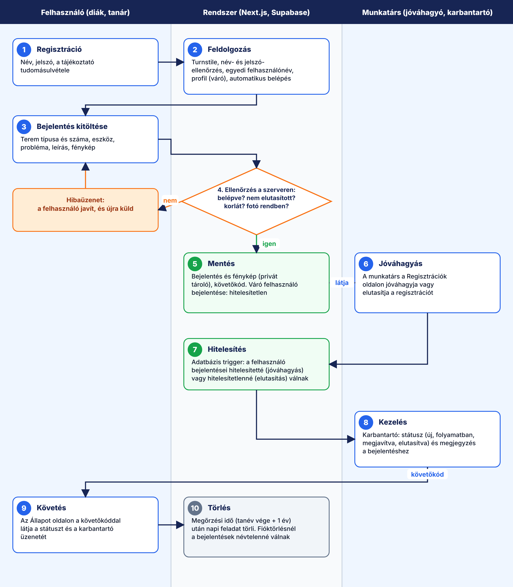
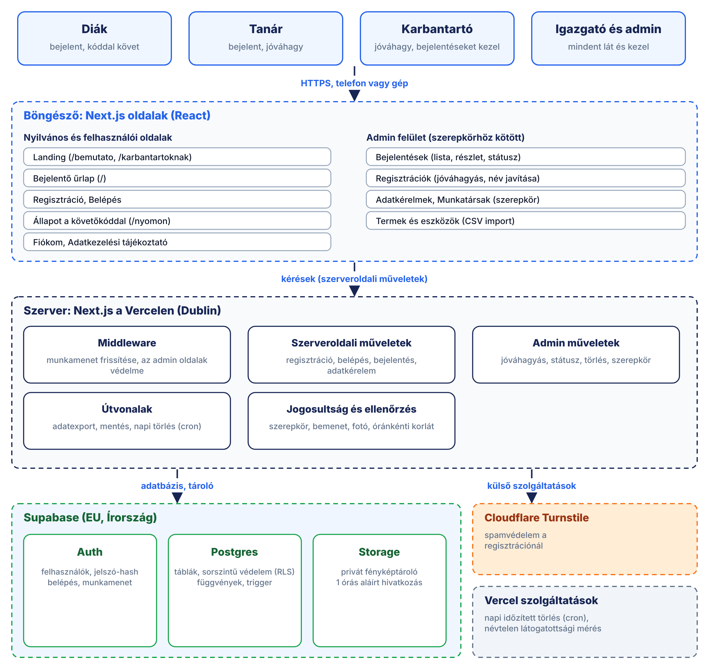
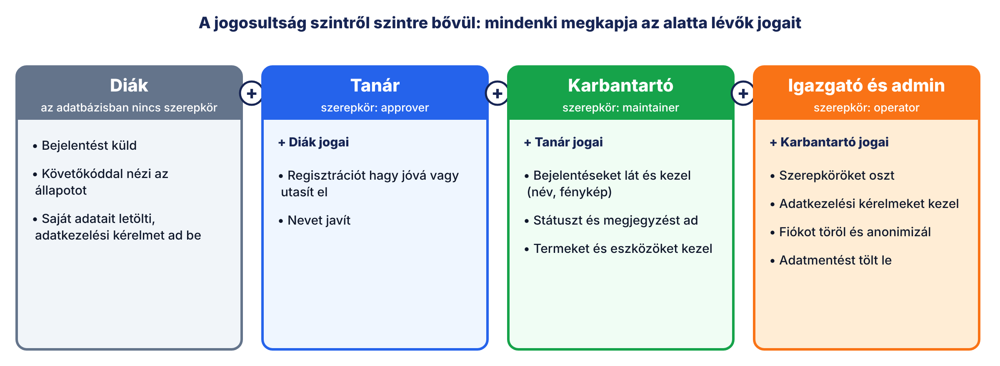
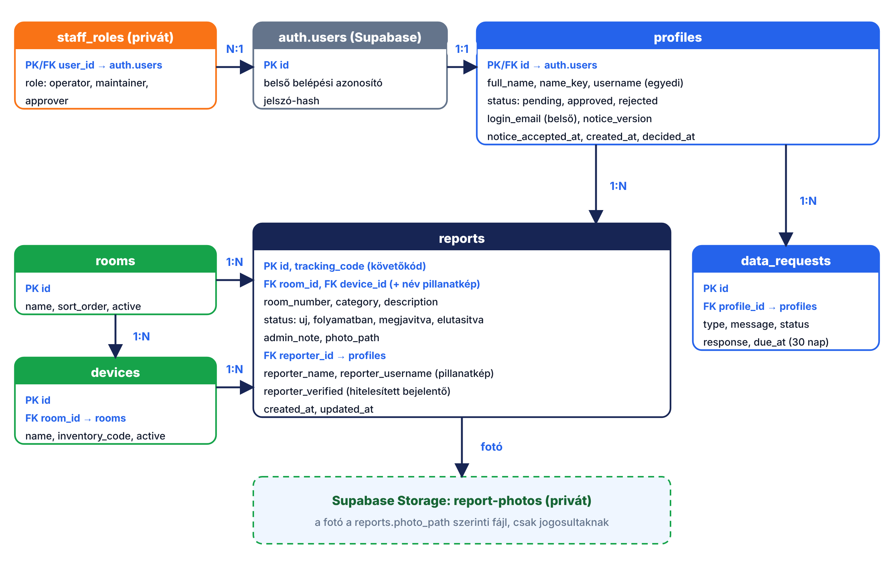

**Projekt:** TechALARM, iskolai hibabejelentő rendszer · **Készült:** 2026. november 25. · **Célközönség:** 12. osztályos szoftverfejlesztő diák

> **Röviden:** a rendszer 2026. október 11. és november 23. között, kb. 6 hét alatt készült el, AI-val végzett munkával (45 commit, kb. 3800 sor forráskód, 9 adatbázis-migráció, plusz plakátok, roll-up, videók, landing oldal és adatvédelmi dokumentumok). Hagyományos úton ugyanez becslésem szerint **kb. 350–550 munkaórát** igényelne, vagyis egy tapasztalt fejlesztőnek 9–14 hetet, egy 12. osztályos diáknak heti 10–12 órában 7–11 hónapot.

# 1. Milyen szoftveres alapismeretek kellenek a folyamatok és a felépítés megértéséhez és menedzseléséhez?

A cél nem az, hogy a diák minden sort maga írjon meg, hanem hogy **értse, mit épít, tudja irányítani, ellenőrizni és megmagyarázni**. A lenti területek ezt szolgálják.

## 1.1 Alapismeretek területenként

| Terület | Mit kell tudni | Hol jelenik meg a TechALARM-ban | Szint |
|---|---|---|---|
| **Programozási alapok** | Változók, elágazás, ciklus, függvény, adatszerkezetek (tömb, objektum), hibakezelés, aszinkron működés (async/await) | A bejelentés mentése, az ellenőrzések, a törlési feladat | Alap |
| **TypeScript és JavaScript** | Típusok, modulok, import és export, objektumok, JSON | Az egész kód (`.ts`, `.tsx` fájlok) | Alap–közép |
| **Webes alapok** | HTML, CSS, reszponzív megjelenítés, HTTP (GET, POST, státuszkódok), sütik, űrlapok | Mobilra szabott űrlap, a landing oldal | Alap |
| **Keretrendszerek** | React komponensek és állapot, Next.js: oldalak, útvonalak, szerveroldali műveletek, middleware | A bejelentő, a belépés és az admin oldalak | Közép |
| **Adatbázis és SQL** | Relációs modell, táblák, elsődleges és idegen kulcs, SELECT, INSERT, UPDATE, DELETE, JOIN, index, migráció, trigger, függvény | `reports`, `profiles`, `rooms`, `devices` táblák, 9 migráció | Közép |
| **Hitelesítés és jogosultság** | Hitelesítés és engedélyezés különbsége, jelszó-hash, munkamenet, szerepkörök, legkisebb jogosultság | Regisztráció, belépés, szerepkör-hierarchia | Közép |
| **Biztonság** | Bemenet ellenőrzése, SQL-injektálás, XSS, hibás hozzáférés-vezérlés, titkok kezelése, fájlfeltöltés biztonsága, spamvédelem, HTTPS | Fotó típus- és méretellenőrzése, korlát, Turnstile, titkos kulcsok | Közép |
| **Felhőszolgáltatások** | Hosting, szerver nélküli függvény, környezeti változó, régió, időzített feladat, fájltároló | Vercel, Supabase, napi törlési feladat | Alap–közép |
| **Verziókezelés és telepítés** | Git: commit, ág, pull request; automatikus telepítés | A kód a GitHubon, a Vercel automatikusan telepít | Alap |
| **Tesztelés és hibakeresés** | Kézi és automatikus teszt, naplók, típusellenőrzés, build, hibajavítás | Típusellenőrzés, build, képernyőképes ellenőrzés | Alap |
| **Szoftvertervezés** | Követelmény, felhasználói történet, adatmodell (ER), folyamatábra, architektúra | A 3. pont ábrái | Alap |
| **Projektmenedzsment** | Prioritás, mérföldkő, backlog, kockázat, dokumentáció, verziózás, csapatmunka | Iterációk, a dokumentumok, a Git előzmények | Alap |
| **UX és UI** | Használhatóság, mobil-első tervezés, hozzáférhetőség, visszajelzések | A kérdőív, a perszónák, az űrlap egyszerűsítése | Alap |
| **Adatvédelem (GDPR) fejlesztőknek** | Adattakarékosság, jogalap, érintetti jogok, megőrzés, incidens, beépített adatvédelem | Tájékoztató, Fiókom, automatikus törlés, szerepkörök | Alap–közép |
| **Mérés és üzemeltetés** | Analitika, naplók, mentés, monitorozás | Vercel Web Analytics, adatmentés | Alap |
| **AI-eszközök használata** | Pontos kérés, kontextus megadása, az eredmény ellenőrzése, kockázatok (kitalált tartalom, kiszivárgó kulcsok) | Az egész projekt | Közép |

## 1.2 Amit a folyamatok menedzseléséhez érteni kell

1. **A felhasználói útvonal:** mi történik a regisztrációtól a törlésig, és ki mit lát (3.1 ábra).
2. **Az adatok útja:** a böngészőből a szerveren át az adatbázisba és a tárolóba, hol van ellenőrzés (3.2 ábra).
3. **A jogosultságok:** ki mihez fér hozzá, és hol kényszeríti ki ezt a rendszer (3.3 ábra).
4. **Az adatmodell:** melyik adat melyik táblában van, és mi kapcsolódik mihez (3.4 ábra).
5. **A telepítés folyamata:** módosítás, commit, push, automatikus telepítés, migráció az adatbázison.
6. **A hibák és kockázatok kezelése:** mi történik, ha elromlik valami, ki kapja a jelzést, hogyan állítható vissza (mentés, napló).
7. **A döntések követése:** miért változott a rendszer (például a névtelenségből regisztráció lett), és mi következett ebből.

## 1.3 Ellenőrző kérdések: ha ezekre tudsz válaszolni, érted a rendszert

- Mi a különbség a hitelesítés és az engedélyezés között, és hol történik mindkettő a rendszerben?
- Miért nem elég, ha a felület elrejti a gombot, és a szerver is ellenőriz?
- Mit jelent az, hogy az adatbázisban sorszintű védelem (RLS) van?
- Mi az a környezeti változó, és miért nem kerülhet a titkos kulcs a kódba vagy a böngészőbe?
- Mi történik egy bejelentéssel a beküldéstől a törlésig?
- Miért van egyedi felhasználónév, ha a név nem egyedi?
- Mi a jogalapja az adatkezelésnek, és miért nem hozzájárulás?
- Hogyan telepítenéd újra a rendszert egy üres adatbázisra?

# 2. Milyen skillekkel és szoftveres megoldásokkal egészítette ki az AI a meglévő tudást?

## 2.1 Képességek (skillek), amelyeket az AI hozzáadott

| Terület | Amit az AI hozzáadott | Amit a diáknak így is tudnia és ellenőriznie kell |
|---|---|---|
| **Teljes webalkalmazás kódja** | Űrlap, követőoldal, admin felület, regisztráció, belépés, adatexport, kérelmek | A működést érteni, kipróbálni, az eredményt átnézni |
| **Adatbázis-tervezés** | Táblák, kapcsolatok, indexek, migrációk, triggerek, függvények | Az adatmodell logikáját megérteni, a követelményeket megfogalmazni |
| **Biztonsági mintázatok** | Sorszintű jogosultság, szerveroldali ellenőrzés, fájlfeltöltés védelme, korlátok, titkok kezelése | Tudni, mit védünk, és miért |
| **Jogosultsági rendszer** | Szerepkör-hierarchia, adatbázis szintű kikényszerítés, munkatársak kezelése | Eldönteni, ki mit láthat és tehet |
| **Üzemeltetés (DevOps)** | Migrációk alkalmazása, telepítés ellenőrzése, kulcsok beállítása, régió beállítása, időzített feladat | A hozzáféréseket kezelni, a változásokat jóváhagyni |
| **Kutatás és elemzés** | A kérdőív kiértékelése, a perszónák, a workshopok feldolgozása, jogi források keresése | A következtetéseket kritikusan olvasni, a forrásokat ellenőrizni |
| **Adatvédelmi tervezés** | Jogalap-javaslat, tájékoztató, nyilvántartás, hatásvizsgálati küszöbelemzés, incidens eljárásrend | A jogi jóváhagyást beszerezni, az adatokat kitölteni |
| **Dizájn és arculat** | A felület, a landing oldal, a logó vektorizálása, rajzolt illusztráció, plakátok, roll-up | Az arculatról és az üzenetről dönteni |
| **Videó és animáció** | Háromdimenziós promóciós videó, 2 perces termékvideó kódból, hang és effektek | A történetet és a minőséget jóváhagyni |
| **Szövegírás és marketing** | Szlogenek, landing szöveg a workshop elvei szerint, megosztási szövegek | A hangnemet és a célcsoportot meghatározni |
| **Dokumentáció** | README, adatkezelési nyilatkozat, folyamatábrák, ez az összefoglaló | A tartalom helyességét ellenőrizni |
| **Minőségellenőrzés** | Típusellenőrzés, build, képernyőképes vizsgálat, adatbázis-tesztek | Valódi felhasználókkal is tesztelni |

## 2.2 Szoftveres megoldások és eszközök a projektben

| Eszköz | Mire szolgál | Hol használtuk |
|---|---|---|
| **Next.js 15, React 19, TypeScript** | A webalkalmazás váza és nyelve | Az összes oldal és szerveroldali művelet |
| **Supabase (PostgreSQL, Auth, Storage)** | Adatbázis, felhasználókezelés, privát fájltároló, EU-s régió | Bejelentések, profilok, fotók, belépés |
| **Sorszintű védelem (RLS), függvények, triggerek** | A jogosultságok kikényszerítése az adatbázisban | Szerepkörök, hitelesítetlen jelzés automatikus frissítése |
| **Vercel** | Üzemeltetés, automatikus telepítés, napi időzített feladat, névtelen látogatottsági mérés | Éles oldal, törlési feladat, analitika |
| **GitHub** | Verziókezelés, a telepítés forrása | A teljes kód és előzmény |
| **Cloudflare Turnstile** | Spamvédelem a regisztrációnál | Regisztráció |
| **Playwright és Chromium** | Képernyőképek, PDF és PNG előállítása, ellenőrzés | Plakátok, roll-up, dokumentumok, ábrák |
| **Remotion és Three.js** | Háromdimenziós videó kódból | Az első promóciós videó |
| **Hyperframes, GSAP, ffmpeg** | HTML-ből videó, animáció, hang, kódolás | A 2 perces termékvideó |
| **SVG és vektorizálás** | Méretezhető logó, ikonok, ábrák | Logó, illusztrációk, folyamatábrák |
| **QR-kód készítés és ellenőrzés** | QR-kódok a plakáthoz, visszaolvasás ellenőrzéssel | A két QR-kódos plakát |
| **Pandoc és Word/PDF előállítás** | Dokumentumok készítése | Adatkezelési nyilatkozat, ez az összefoglaló |
| **Inter betűtípus, CSS** | Egységes megjelenés | Weboldal, plakát, dokumentumok |

## 2.3 Telepített AI-skillek és csatlakozók

- **brag** és **brag-slim:** termékvideó készítése a projektről.
- **hyperframes** és kapcsolódó skillek: videó kompozíciók építése, ellenőrzése és renderelése HTML-ből.
- **watch** (claude-video): videók megtekintése képkockákból és átiratból.
- **Supabase és Vercel csatlakozó:** az adatbázis és az üzemeltetés kezelése közvetlenül az AI-ból (migrációk, ellenőrzés, beállítások).
- **Dokumentum- és weboldalkészítő képességek:** Word, PDF, SVG, PNG előállítása.

# 3. A szoftver logikai felépítése folyamatleíró ábrákkal

## 3.1 ábra: A fő folyamat a regisztrációtól a törlésig

{width=6.2in}

**Hogyan olvasd:**

1. Három sáv van: a felhasználó, a rendszer és a munkatárs. Minden lépés abban a sávban van, amelyik végrehajtja.
2. A regisztráció (1–2) után a felhasználó rögtön be van léptetve, és bejelenthet (3).
3. A narancs rombusz (4) az ellenőrzés a szerveren. Ha valami nem stimmel, hibaüzenetet kap, és javít. Ha minden rendben van, a rendszer elmenti a bejelentést (5).
4. Amíg a regisztrációt nem hagyták jóvá, a bejelentés hitelesítetlen. A jóváhagyás (6) után az adatbázis trigger automatikusan hitelesítetté teszi (7).
5. A karbantartó kezeli a bejelentést (8), a felhasználó a követőkóddal nézi az állapotot (9).
6. A megőrzési idő lejárta után az adat automatikusan törlődik (10).

## 3.2 ábra: Logikai felépítés rétegekben

{width=6.2in}

**Hogyan olvasd:**

1. **Felhasználók:** a négy szereplő telefonról vagy számítógépről éri el a rendszert HTTPS-en.
2. **Böngésző:** a Next.js oldalak, külön a nyilvános oldalak és az admin felület.
3. **Szerver:** a Vercelen futó Next.js. Itt van a munkamenet kezelése, a bemenet és a jogosultság ellenőrzése, az adatmódosító műveletek és az időzített törlés.
4. **Szolgáltatások:** a Supabase (belépés, adatbázis, fotótároló, EU-ban), a spamvédelem és a Vercel saját szolgáltatásai.
5. **Alapelv:** a böngészőre nem bízunk semmit, minden fontos ellenőrzés a szerveren és az adatbázisban történik.

## 3.3 ábra: Szerepkörök és jogosultságok

{width=6.2in}

**Hogyan olvasd:**

1. A jogosultság szintről szintre bővül, és minden szint megkapja az alatta lévő jogait.
2. A diák csak bejelent és a követőkóddal nézi az állapotot, a tanár ezen felül a regisztrációkat hagyja jóvá.
3. A karbantartó a bejelentéseket is kezeli, az igazgató és az admin mindent lát és kezel.
4. Az adatbázis szerepkörei (`approver`, `maintainer`, `operator`) ugyanezt a hierarchiát követik, így a szabályt a felület megkerülésével sem lehet kijátszani.

## 3.4 ábra: Adatmodell

{width=6.2in}

**Hogyan olvasd:**

1. A `reports` tábla a központ: egy bejelentés egy teremhez, egy eszközhöz és egy bejelentő profiljához tartozik.
2. A `profiles` tábla a Supabase belépési fiókjára épül (1:1), és tárolja a nevet, az egyedi felhasználónevet és a jóváhagyás állapotát.
3. A név és a felhasználónév pillanatképként is a bejelentésen van, hogy a fiók törlése után a bejelentés névtelenül megmaradjon.
4. A `staff_roles` külön, a nyilvános felülettől elzárt táblában tárolja a szerepköröket.
5. A fénykép nem az adatbázisban, hanem a privát tárolóban van, a `photo_path` mutat rá.

# 4. Mennyi idő lenne a szoftvert hagyományos módon lefejleszteni?

## 4.1 A becslés alapjai

- A becslés a **mostani teljes tartalomra** vonatkozik: webalkalmazás, admin felület, regisztráció és szerepkörök, adatvédelmi funkciók, landing oldal, plakátok, roll-up, két videó és a dokumentumok.
- Az idők **munkaórák**, egy tapasztalt fejlesztő vagy designer tempójában, tesztelést és javítást is beleértve. Ez becslés, nem mérés.
- A valódi időt az is befolyásolja, hogy a követelmények menet közben változtak (például a névtelen bejelentésből regisztráció lett), ami hagyományos úton is plusz munkát jelentett volna.

## 4.2 Időbecslés modulonként

| Modul | Hagyományos fejlesztés (óra) | Megjegyzés |
|---|---|---|
| Követelmények, kérdőív, perszónák, tervezés | 20–30 | Interjúk, kérdőív, elemzés |
| Adatmodell, adatbázis, migrációk, jogosultsági szabályok | 20–30 | Táblák, kulcsok, RLS |
| Bejelentő űrlap, validáció, fotófeltöltés, követőoldal | 30–45 | Mobil, hibakezelés, képkicsinyítés |
| Regisztráció, belépés, felhasználónév, hitelesítetlen jelzés, spamvédelem | 30–40 | Biztonságos jelszókezelés |
| Admin felület: lista, szűrők, részlet, státusz, termek és eszközök, CSV-import | 40–55 | |
| Szerepkör-hierarchia és munkatársak kezelése | 20–30 | Felület és adatbázis |
| Adatvédelmi funkciók: tájékoztató, Fiókom, export, kérelmek, törlés és anonimizálás, napi törlés, mentés | 30–45 | |
| Landing oldal, reszponzív megjelenés, animációk, analitika, SEO | 30–45 | |
| Tesztelés, hibajavítás, telepítés, üzemeltetés | 30–50 | |
| **A szoftver összesen** | **250–370** | |
| Arculat, logó, roll-up, plakátok, két videó | 80–140 | A videók a legnagyobb tétel |
| Dokumentáció, adatvédelmi dokumentumok (jogi egyeztetés nélkül) | 25–40 | |
| **Mindösszesen** | **355–550** | |

## 4.3 Mit jelent ez naptári időben?

| Ki végezné | Ráfordítás | Becsült időtartam |
|---|---|---|
| **Tapasztalt fejlesztő**, egyedül, heti 40 óra | 355–550 óra | **9–14 hét** |
| **12. osztályos diák**, egyedül, heti 10–12 óra, a tanulással együtt (+30–50%) | 460–800 óra | **kb. 7–11 hónap** |
| **Négyfős diákcsapat**, fejenként heti 8–10 óra, jó munkamegosztással | ~500–700 óra összesen | **kb. 3–5 hónap** |
| **AI-val végzett munka** (a tényleges projekt) | nincs mérve | **kb. 6 hét** naptári idő |

## 4.4 Mit gyorsított az AI, és mit nem?

1. **Jelentősen gyorsított:** a kód és az adatbázis megírása, a biztonsági és üzemeltetési minták, a dokumentumok, a videók és a grafikai anyagok, a hibák felkutatása.
2. **Nem gyorsult:** a követelmények tisztázása, a döntések, a valódi felhasználókkal való tesztelés, a jogi egyeztetés és a hozzáférések, aláírások intézése.
3. **Új feladatot hozott:** az eredmény átnézése és ellenőrzése, a pontos kérés megfogalmazása, a kockázatok (kitalált tartalom, kulcsok védelme) kezelése.
4. **A tanulságok:** az AI a megvalósítás idejét lecsökkentette, de a felelősség és a döntések továbbra is a fejlesztőé. Egy diák számára ezért az az érték, hogy a rendszert **érti, irányítja és meg tudja védeni**, nem az, hogy minden sort kézzel gépelt.
